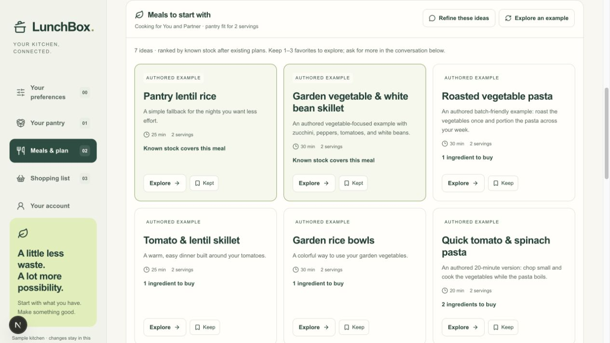

# Friday user acceptance benchmark

**Success criteria update — October 21, 2026:** Alex now prioritizes time saved through effortless, intuitive use, with a 10× ambition against the user's existing routine; home cooking from real ingredients comes second, food spending and waste third. Read the [v2 product outcome contract](../.agents/skills/lunchbox-friday-reviewer/references/success-criteria.md) for baselines, total-work timing and evidence requirements. The assessment below remains the unchanged **v1 historical usability baseline**. Its 61/100 score and proposed 85/100 interface target do not establish the time advantage, cooking or savings outcomes; those are unmeasured here.

Assessment date: **October 19, 2026 (Pacific)**. Scored source: **`28b2935dd8c6a279f1b0fc9feb28012af8579627`**, merged PR #31. The concurrent `codex/chat-first-meal-planning` implementation and its prototype are excluded. This is a **provisional expert review, not measured user acceptance**.

The reusable [Friday reviewer skill](../.agents/skills/lunchbox-friday-reviewer/SKILL.md) defines Alex, the fixed tasks F-01–F-08, scoring anchors, reporting rules and proposed acceptance targets. It can be used directly from this repository or installed in a personal Codex skills directory. The installed personal copy is an installation snapshot; update it from the repository version when the rubric changes.

## Intent and persona

Alex is a synthetic household cook derived from Nate's [October 16 Friday story and audit](https://linear.app/b4cklash/document/friday-planning-audit-and-conversation-first-product-vision-2026-10-16-bf2697d22fb2), tracked by [B4C-93](https://linear.app/b4cklash/issue/B4C-93). Alex wants fresh, easy, fall-inspired options using existing food, suitable saved recipes, and a useful combined grocery list before deciding dates. Partial pantry knowledge and changes of mind are normal. Alex asks: **“Did this help me decide what to cook, or give me another job?”** This is a proposed review lens, not a claim about research participants or all users.

## Baseline score: 61/100

These are judgment-based ratings of the current experience. The number organizes priorities; it is not a conversion rate, percentile, standardized usability score, or a statistical estimate. Confidence is **medium for local interface friction and source capabilities, low for live service quality and real-world ease**. Small numeric differences should not be interpreted as measured improvement.

| Dimension | Weight | Rating / 5 | Points | Why |
| --- | ---: | ---: | ---: | --- |
| Welcome and first value | 15 | 2.5 | 7.5 | Warm visual identity and useful starter ideas; multiple status bands, modes and a four-stage journey precede the conversation. |
| Relevant discovery and saved recipes | 20 | 3 | 12 | Pantry fit and eligibility filtering exist; current free-text intent and explicit saved-recipe preference do not drive discovery ranking. Historical live API probes did not yield a reliable card flow. |
| Conversation and continuity | 15 | 3.5 | 10.5 | Shortlist and conversation coexist; selected recipes survived the inspected example response. Composer is far down the initial page, and form-driven handoffs remain. |
| Groceries before scheduling | 20 | 2 | 8 | One-candidate preview and saved-batch combined groceries work. Multi-recipe unscheduled groceries and in-recipe stock correction are missing. |
| Trust, control and recovery | 15 | 4.5 | 13.5 | Honest fixture/source labels, reviewed commands, Undo and validation have substantial evidence. Incomplete inventory can still turn unknown food into a buy quantity. Fresh failure/reload tests were not run here. |
| Mobile and everyday use | 15 | 3 | 9 | Responsive implementation and earlier phone-viewport evidence exist; physical-phone, two-person and real shopping/cooking acceptance remain open. Rating is provisional. |
| **Total** | **100** | | **60.5 → 61** | **Useful infrastructure; too much user assembly for the Friday job.** |

## Task outcomes and evidence

| Task | Current outcome | Evidence and limit |
| --- | --- | --- |
| F-01 Start | Partial | Fresh isolated local browser on `127.0.0.1:3137/meals?sampleKitchen=1`: seven clearly labeled authored ideas. At 1280×720, composer top was about 2256 CSS px from the initial viewport top. The fictional-kitchen warning adds height; the October 16 production audit independently found chat below cards/shortlist. This is page geometry, not observed user time. |
| F-02 Discover/refine | Partial | Example response to “Fall, healthy, fresh lunches for two…” offered an authored roasted-vegetable-pasta fixture. Honest labeling; no live recommendation or seasonality proof. [Recipe ranking](../src/features/planning/recipe-ideas.ts) sorts stock readiness/shortages/checks then original order; candidates precede saves on equal fit. |
| F-03 Keep | Partial | Kept lentil rice and vegetable/bean skillet; used Refine, sent the request, and inspected another recipe. Both original keep controls remained selected after the response. Fresh saved-kitchen navigation/reload was not tested; prior persistence evidence is in the October 13 report. |
| F-04 Check stock | Fail for desired path | Inspected pasta ingredients: quantities and steps are visible, without stock correction controls. [RecipeDetail](../src/components/planning-workspace.tsx) is display-only. [knownStock](../src/features/planning/pilot.ts) returns zero when no row exists unless qualitative/package evidence establishes uncertainty; an unrecorded ingredient can therefore appear as a definite shortage. |
| F-05 Combined groceries before dates | Fail | Two kept recipes offer no combined grocery action. Inspection shows only “Extra groceries for this candidate”; live groceries change after planning a batch. Source confirms single-candidate preview. A helper under development in another chat is excluded. |
| F-06 Optional schedule | Partial, historical | October 16 audit demonstrated one four-portion Sunday batch, one portion per person for Mon/Tue lunches, dinner gaps still open, and 360 g pasta to buy once. Manual construction works; conversational end-to-end planning is not proved. |
| F-07 Recovery | Not run fresh | October 13 report covers validation, Undo and device-local persistence boundaries. Two October 16 non-persisting live probes returned prose/no cards (200) and invalid output (502). Neither the old passing tests nor two failed probes establish a current reliability rate. |
| F-08 Everyday devices | Not run fresh | October 13 report verified 390×844 viewport layout, explicitly excluding physical-phone and participant acceptance. This assessment adds no partner/device evidence. |

Fresh local inspection used the pinned Node 24.21.0/npm 11.19.0 runtime, a clean source worktree and fictional stock; no production data, real household, live worker or paid AI request was changed. The example path rendered locally and preserved inspected keep selections, but its first live-assistant boundary is intentionally unavailable in sample mode. That boundary is unverified rather than passed.

Starting fixture: fresh `sampleKitchen=1` at the scored source, using [createSampleHousehold](../src/features/pantry/seed.ts) and the normal pilot migration, browser date October 19, 2026. No stock/preferences/servings or dates were edited; audience displayed You + Partner and pantry fit for two. The candidate preview displayed an October 25 shopping horizon. Kept recipes and exact request are recorded in F-02/F-03. No suitable saved-recipe retrieval was browser-tested; that dimension uses source and historical evidence. Future comparisons should record the same fixture/input manifest rather than attributing a different pantry's results to a feature change.

## Comparison with inviting experiences

This is a comparison against documented behaviors and design principles, **not a scored head-to-head usability study**.

| Reference | Behavior to meet | LunchBox today |
| --- | --- | --- |
| [AnyList Meal Plan Queue](https://help.anylist.com/articles/meal-plan-queue/) | Gather recipes and send ingredients to shopping without choosing calendar dates. | Largest direct gap: a shortlist cannot yet deliver the combined unscheduled list. |
| [Mealime getting-started guide](https://support.mealime.com/article/151-getting-started-guide) | Offer useful meal selections, allow serving adjustments, combine grocery quantities. | Similar underlying capabilities, but the user must traverse more planning structure. This vendor guide is older documentation, not a verified current-screen comparison. |
| [NN/g progressive disclosure](https://www.nngroup.com/articles/progressive-disclosure/) | Prioritize common actions and reveal secondary detail when useful without creating needless stages. | Visual warmth is present; modes, multiple header bands, settings and numbered stages compete with the primary conversation. |

The aspiration is to feel calm, relevant and easy to resume. More recipes or more controls do not earn points unless they improve a tested user task. Preserve LunchBox's strengths in explicit review, honest source labels and correct stock accounting while simplifying presentation.

## Improvement order and acceptance target

1. **Make the current intent the front door.** Composer visible immediately, suitable saves prominent, concise relevant cards, selections preserved through refinement. Show real loading/empty/error states.
2. **Complete the grocery payoff before asking for dates.** Two kept recipes plus total portions produce one combined preview; shared stock is subtracted once; no plan save or pantry deduction is needed.
3. **Let recipes teach the pantry.** Confirm “have some / enough / out / not sure” beside the ingredient without losing the recipe or inventing package conversions. Clearly distinguish absent records from confirmed absence.
4. **Observe the Friday story on the revised app.** Prove a supported live assistant path, then have Nate complete the task on desktop and a physical phone; keep partner/real-cycle release acceptance separate.

Proposed internal goal: **85/100**, every dimension at least 3.5/5, observed F-01–F-07 completion without facilitator rescue, and no correctness/data-loss/unsupported-action blocker. These are proposed product thresholds, not an industry standard. Initial timing hypotheses are useful options within 60 seconds and a usable combined list within five minutes; calibrate after the first three observed sessions. No timings or human ease/confidence scores were collected for this baseline.

Keep [HP-10](https://linear.app/b4cklash/issue/B4C-85) open for its actual protected household, physical-device, two-person, shopping/cooking and recovery requirements. A higher heuristic score does not enable production households.

## Repeatable review record

For each accepted feature slice, add a dated review recording commit/environment/mode, affected F IDs, pass/partial/fail/not-run evidence, raw dimension ratings and weighted change, remaining blockers, and the next smallest improvement. Separate prototype review, source review, fixture browser checks, live service runs and human sessions. Preserve this baseline rather than rewriting it as new features land.

Example invocation: `Use $lunchbox-friday-reviewer to review this LunchBox feature against the Friday benchmark. Compare it with the October 19 baseline, show evidence for score changes, and identify the next user-facing blocker.`

## Evidence sources and validation

- [October 16 canonical audit](https://linear.app/b4cklash/document/friday-planning-audit-and-conversation-first-product-vision-2026-10-16-bf2697d22fb2): deployed interface, live probes, manual scheduling; historical evidence clearly dated above.
- [October 13 implementation/browser report](RECIPE_FIRST_REVIEW_2026-10-13.md): saved state, portions, validation, viewport evidence and retained limits.
- [Journey decisions](RECIPE_JOURNEY_DESIGN.md): progressive discovery, ingredient confirmation and optional dates.
- [Household delivery gates](HOUSEHOLD_PILOT_DELIVERY.md): implementation versus participant and release acceptance.

Validation: fresh pinned-runtime `npm ci`, `npm run check` (lint, type checking, 473 tests passed; one optional database test skipped), and `npm run build` passed. The skill validator passed for repository and installed copies; local links, score arithmetic and installation parity were checked. An independent forward-test correctly rejected converting a beautiful prototype and helper tests into human acceptance or an unsupported three-minute mobile claim. Local fixture browser scope and its limitations are recorded above. No application behavior is changed by this benchmark.

October 21 criteria update: fresh install, check (473 passed, one optional skip) and build passed again on this documentation branch. Updated repository/installed skills validate and match; 22 local links resolve. A fresh independent skill trial counted two UI minutes plus eight required pantry-entry minutes as ten total, rejected unobserved food/money benefits, and identified a regression against a four-minute alternative. This validates the review instructions, not app performance. No new application or human-session score was produced.
