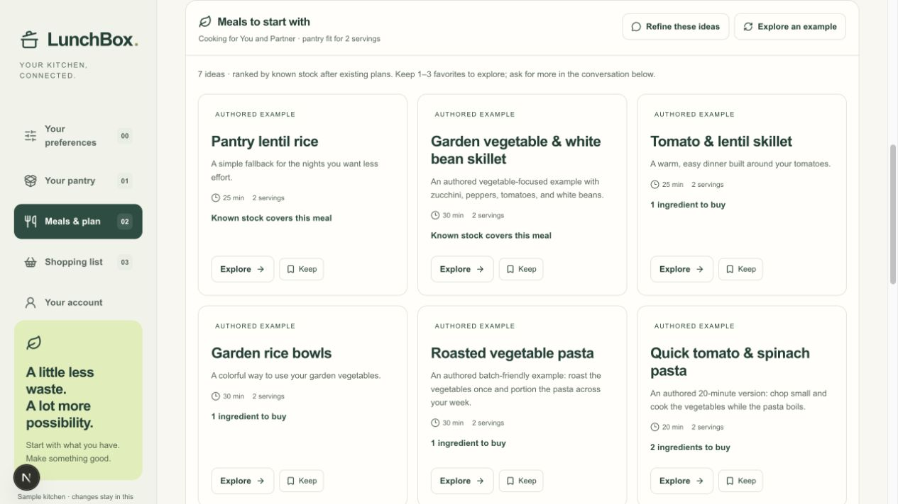
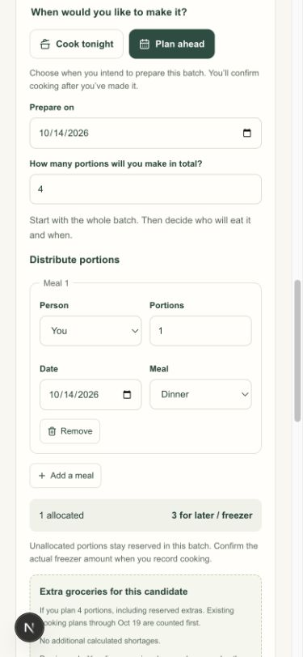

# Recipe-first planning review — 2026-10-13

## User story and scope

Nate's first solo desktop HP-10 session identified the meal-planning layout as clunky. This follow-up takes the existing pilot from pantry-supported ideas → shortlist and conversation → ingredients → cook tonight/plan ahead → total portions and distribution → calendar, groceries and explicit cooking confirmation.

Branch `codex/recipe-first-planning` starts from merged main `4667b6f18a66c774fc108a5845c2cf4cce729a37`. Roadmap ownership remains [HP-01/B4C-76](https://linear.app/b4cklash/issue/B4C-76), [HP-06/B4C-81](https://linear.app/b4cklash/issue/B4C-81) and [HP-07/B4C-82](https://linear.app/b4cklash/issue/B4C-82). [HP-10/B4C-85](https://linear.app/b4cklash/issue/B4C-85) records the participant feedback and remains In Progress. PR #30's staged acceptance documentation is separate from this application change.

## Behavior

- `/meals` starts with up to ten ranked snapshots. Current audience/preferences and equipment filter candidates; current stock, existing cooking commitments and package checks determine the displayed fit. Source labels distinguish AI, imports and authored examples. Seven starter examples supplement the growing library; one AI response still has the existing three-recipe limit.
- Keep roughly one to three recipes in a temporary shortlist, bounded to ten. It uses the existing device/account/session composer cache, survives rerolls and navigation/reload, and retains full recipe snapshots. An asynchronous focus/save cannot overwrite newer shortlist edits. Kept recipes that no longer fit current preferences receive a review label.
- The full-width conversation stays mounted through all four stages. Direct refinement/return controls avoid manual scrolling. Ingredient details open during inspection; explicit revision requests use the existing AI transport and source-faithful imports remain unchanged.
- Cooking intent precedes total portions. Allocate that fixed total across people, dates and meals; unallocated portions remain generic reserves for later/freezer. Review revalidates against current membership, coverage, stock and plans. Save issues one existing `create_batch` command. Planning never deducts stock or creates prepared food. Successful save resets the form so another batch of the same recipe can be planned.
- A cooking-batch summary makes reserve-only and outside-the-visible-week plans discoverable. Actual frozen portions start at zero in the cooking form and must be entered when confirming cooking.
- Sample/random entry opens a separate tab via a full navigation. The experiment uses the existing household schema in memory, with no real profile/history copied. Random stock contains nineteen canonical ingredients with measured grams/ml or whole individual counts. Return/reload discards experiment changes. Account/sharing and AI transports cannot operate on experimental state; even `/recipes` uses the example planner in this mode. No new storage key, provider, schema, database or model is introduced.

## Verification

Pinned tools: Node **24.21.0**, npm **11.19.0**, committed lockfile; fresh `npm ci` passed. `npm run check` passed **469 tests**, with one existing optional database integration test skipped; lint and type checking passed. `npm run build` passed.

Local browser verification used `localhost:3100`, desktop **1265 × 712** and phone viewport **390 × 844**. Phone viewport testing is not a physical mobile-device acceptance pass. Local authentication was unconfigured; no real participant account was used and no hosted inference or two-person sync is claimed by these checks.

| Boundary/scenario | Evidence |
| --- | --- |
| Initial discovery and inspection | Ideas precede calendar. Seven source-labeled starter cards rank stock-covered meals first. Exploring one keeps other options available. Ingredients/steps open; choosing a recipe does not create a batch. |
| Conversation and shortlist | Keep → example reroll preserved the kept snapshot. Refine focused the textarea; Meal ideas returned directly to cards. Existing conversation remained available through stages. Cache tests cover older saves, invalid optional data and reload. |
| Fixed total and command | Six portions, two meal rows allocating two and one, left three reserved. Review displayed six and Save created one six-portion batch and the two allocations. Known lentils stayed 500 g until actual cooking. Shopping required 750 g and showed only the 250 g remainder. |
| Validation and recovery | Eight allocated against six blocked Review with a visible explanation. Reducing an allocation enabled Review. Insufficient stock rejected Confirm cooked, keeping the plan and quantities. The new form preserves failed saves; domain tests exercise stale membership/coverage and duplicate IDs. |
| Repeat/reserve-only/outside week | Returning to the same recipe presented a fresh form. A second two-portion reserve-only batch prepared November 1 saved independently and appeared in Cooking batches although the visible calendar was October 13–19. Shopping's saved October 19 horizon stayed unchanged. |
| Mobile | Intent buttons, total portions, person/date/meal rows, remainder and grocery preview fit the phone viewport. No horizontal overflow appeared in the inspected screens. |
| Empty and Undo | “We don't like vegetables” in the experiment produced zero fitting ideas and a saved-action receipt. Undo after typing another draft restored seven ideas while preserving transcript and draft. |
| Sample isolation | Sample `/recipes` showed the example planner, account navigation blocked account forms, randomization produced nineteen pantry rows, and sample plans stayed in the tab. Returning restored identical visible saved-pantry content, including existing package observations. Browser API does not expose storage inspection; byte-for-byte cache preservation is supported by static boundary review, not claimed as a browser measurement. |
| Requests/logs | Local server logs showed page requests, with no `/api/household` command/job or AI endpoint requests during sample experiments. Browser console had no application errors; a development Fast Refresh warning occurred during edits. |

Cross-owner reviews covered pantry/cache isolation, AI transport mounting, planning commands and serving validation. Fixed review findings: asynchronous shortlist overwrite; reusing an already-saved batch ID; implicit freezer quantity. The browser walkthrough also caught disappearing starter options after exploration; a regression test now keeps those alternatives available. No remaining code blocker was reported.

## Retained limits and release gate

All **19 frozen model-source hashes** match `evaluations/local-ai-qwen35-27b-merge-review-2026-10-10.json`. The evaluated worker/planner/provider/contracts/profile/stock sources are unchanged. This UI follow-up does not claim a fresh model run or improve the previous **64/66 expanded, 40/40 original** evidence. Category-generation safe rejections and prose limitations remain documented in the merge review.

Sample experimentation uses authored examples, not live AI against fictional inventory. The saved kitchen retains its existing authenticated AI behavior. Shortlists are device/session-local, not partner-synced. In-recipe stock editing, combined unscheduled multi-recipe previews, bulk scheduling, package conversion and changes to cancellation of saved allocations remain outside this focused follow-up.

Nate's desktop report is valuable participant evidence, but not a checklist-wide pass. Rerun the revised desktop flow, then use the same account on a physical phone, then test two distinct people, actual planning/shopping/cooking and recovery. **Production household enablement stays off until HP-10 passes and release is reviewed.** Read-only canonical production `/api/household` inspection on October 13 returned **HTTP 503 `household_unconfigured`**. No production flags, credentials, invitations or deployed pilot source were changed by this follow-up.
